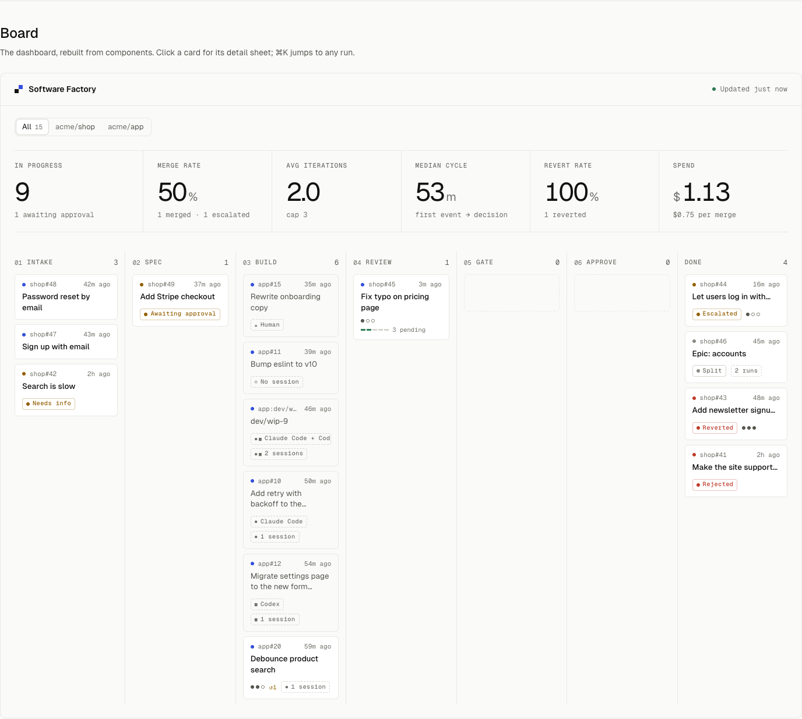

# Software Factory

A Claude Code skill that takes a GitHub issue through intake, spec, build, a multi-axis review gate and approval, ending in a merged PR or a human escalation. It keeps a live dashboard of every run.

| Path | What |
|---|---|
| [`packages/factory`](packages/factory) | The skill (`SKILL.md`) and its zero-dependency CLI, `factory.mjs` |
| [`packages/design-system`](packages/design-system) | Design tokens and React components for the planned desktop app |
| [`apps/playground`](apps/playground) | Vite playground for the design system, with board and run-detail mocks |
| [`docs/architecture.md`](docs/architecture.md) | Folder structure, components, data model, flows, CLI examples |
| [`docs/research`](docs/research) | Background research reports |

## Quick start

```bash
pnpm install
pnpm build                                       # every package's build
pnpm test                                        # design-system contrast + every package's tests
pnpm dev                                         # design-system playground at http://localhost:5199
pnpm --filter @software-factory/factory test     # factory self-test only
FACTORY_DIR=$(mktemp -d) node packages/factory/factory.mjs demo   # sample dashboard, no GitHub needed
```

To use the skill in Claude Code, link it into your skills folder:

```bash
ln -s "$PWD/packages/factory" ~/.claude/skills/software-factory
```

Then say "factory owner/repo#123" in Claude Code. See [docs/architecture.md](docs/architecture.md) for details.

## Monorepo

A plain pnpm workspace. Each package owns its scripts, and the root `pnpm build` and `pnpm test` run them across the workspace
(`pnpm -r`). Desktop work will land in `apps/desktop` (Electron, planned) and consume `packages/design-system`.
See [CONTRIBUTING.md](CONTRIBUTING.md) for the workflow and [SECURITY.md](SECURITY.md) for reporting vulnerabilities.



## License

[Apache-2.0](LICENSE).
